# Sales Dashboard

A field-sales tracker for distributors and small businesses. Salesmen record sales from their phones, the owner sees everything live, and **every sale, credit and payment is linked** — so you always know who bought what, who still owes, and which payment settled which sale.

It runs on **Google Apps Script + Google Sheets**: no server to rent, no database to manage, and your data stays in your own Google Drive.

## ▶ [Try the live demo](https://celalcelikkaya.github.io/Field-sales-tracker/) &nbsp;|&nbsp; 📥 [Download v1.0.0 (ZIP)](https://github.com/celalcelikkaya/Field-sales-tracker/releases/download/v1.0.0/sales-dashboard-v1.0.0.zip)

The demo runs the real backend inside your browser with sample data. Nothing is sent anywhere. Admin PIN **1234**, salesman PIN **1111**. Reload the page to reset it.

  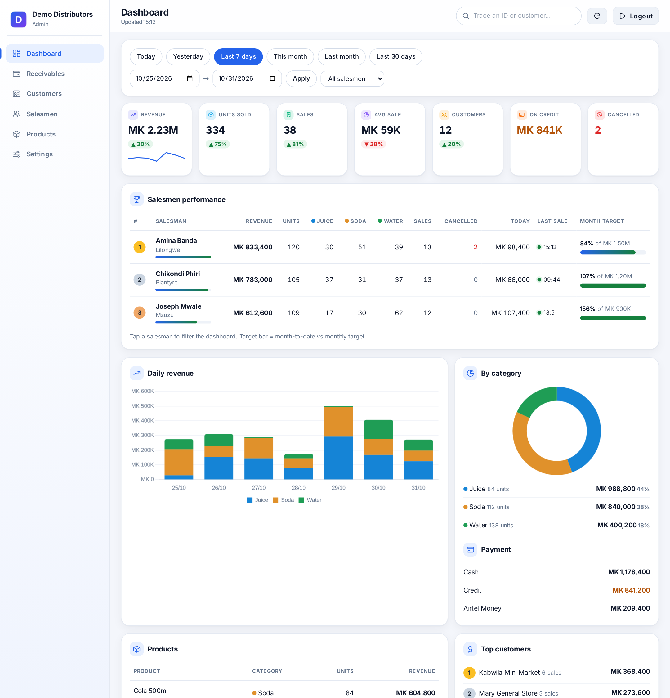

## Why people use it

| | |
|---|---|
| **Sell in seconds** | Phone-first screen: pick products, pick the customer, save. Works with a weak connection — sales are queued on the phone and sent automatically when the signal returns. |
| **One customer = one record** | Customers have IDs. Typing "Chikondi Shopp" suggests "Chikondi Shop" instead of silently creating a duplicate. Admins can rename and merge customers without breaking history. |
| **Credit that makes sense** | A credit sale is an invoice: *Unpaid → Part paid → Paid*. A payment is applied to the oldest unpaid sales (or the ones you choose), so you always know which sale it paid. |
| **Trace anything** | Type any sale, payment or customer ID in the search box and see every linked record and the full timeline. Click through the web of links. |
| **Tamper-evident audit trail** | Every sale, edit, cancellation, payment and customer change is written to an append-only ledger where each entry carries the fingerprint of the previous one. One click verifies the chain. |
| **Nothing is deleted** | Cancelled sales and payments stay on record with who, when and why. Corrections are "cancel + re-enter" and stay linked. |
| **Your brand, your products** | First-run wizard: company name, logo, currency, time zone, products with sizes and prices. Works for any product line, not just one industry. |
| **Light & dark** | Follows the device theme automatically. |

## Screenshots

| Receivables | Customers |
|---|---|
| 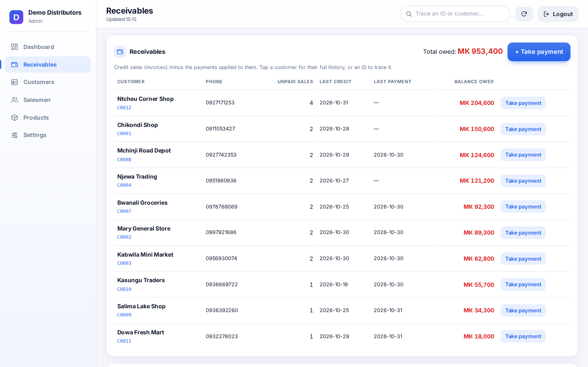 | 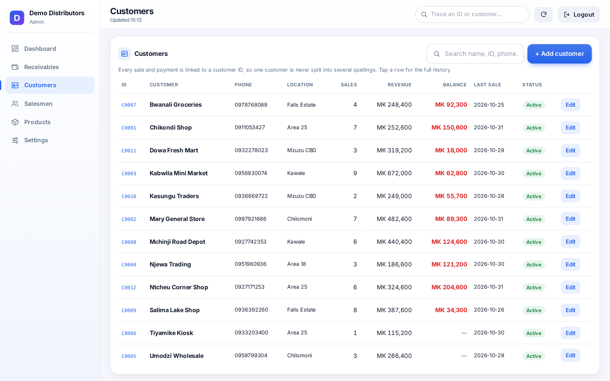 |

| Trace any ID | Customer history |
|---|---|
| 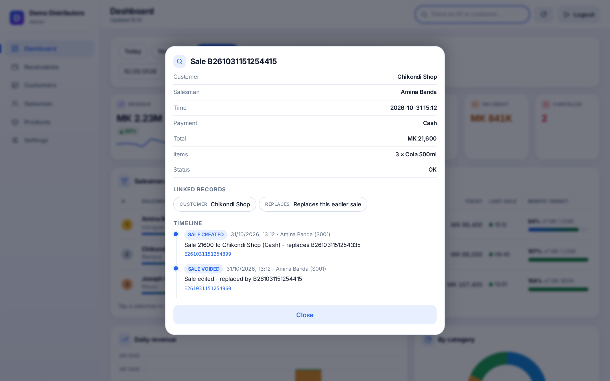 | 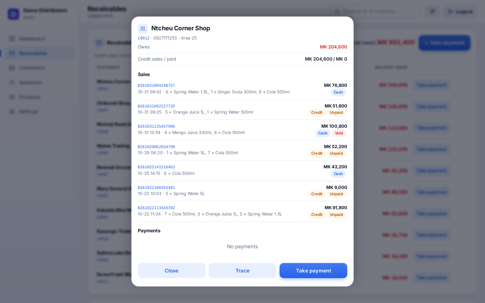 |

| Allocate a payment to specific sales | Settings, audit trail and reset |
|---|---|
| 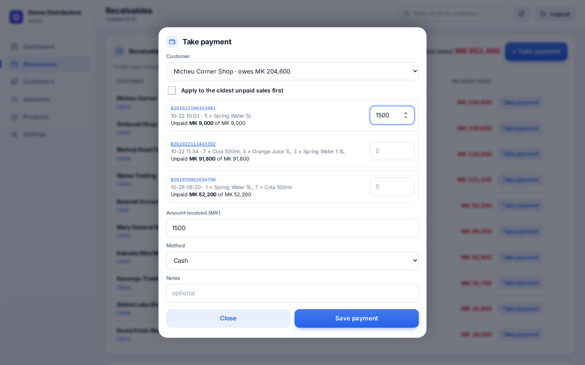 | 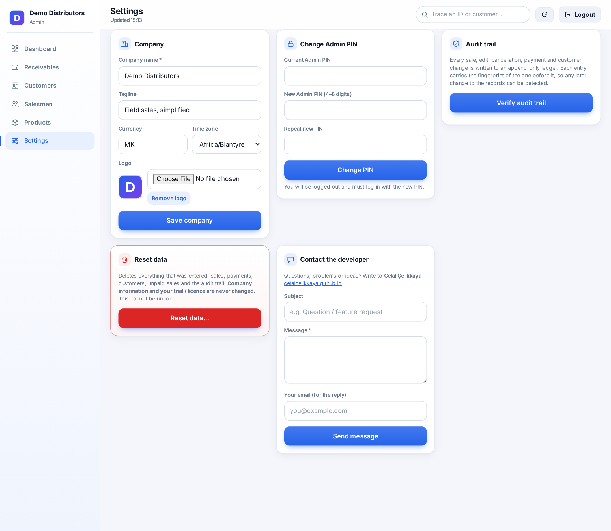 |

**Dark mode, setup wizard and the reset dialog**

| Dashboard (dark) | Setup wizard | Reset data |
|---|---|---|
| 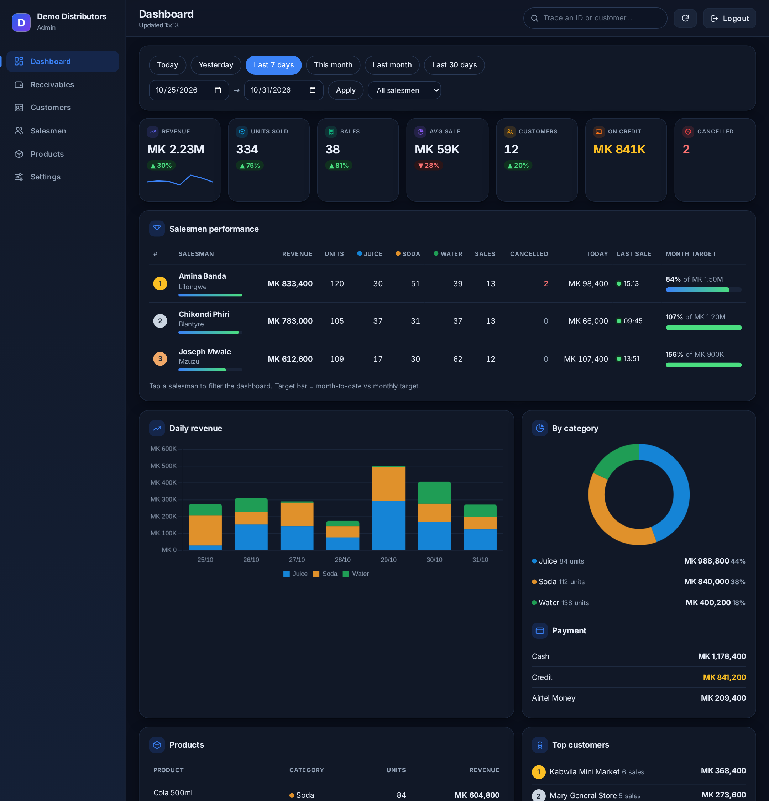 | 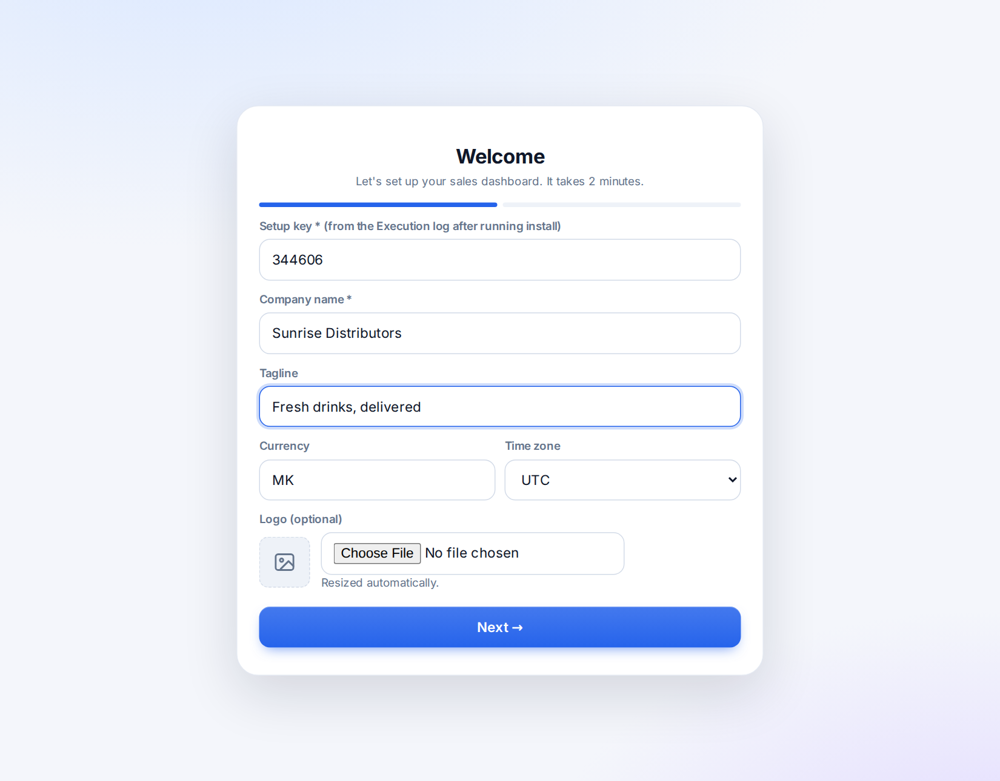 | 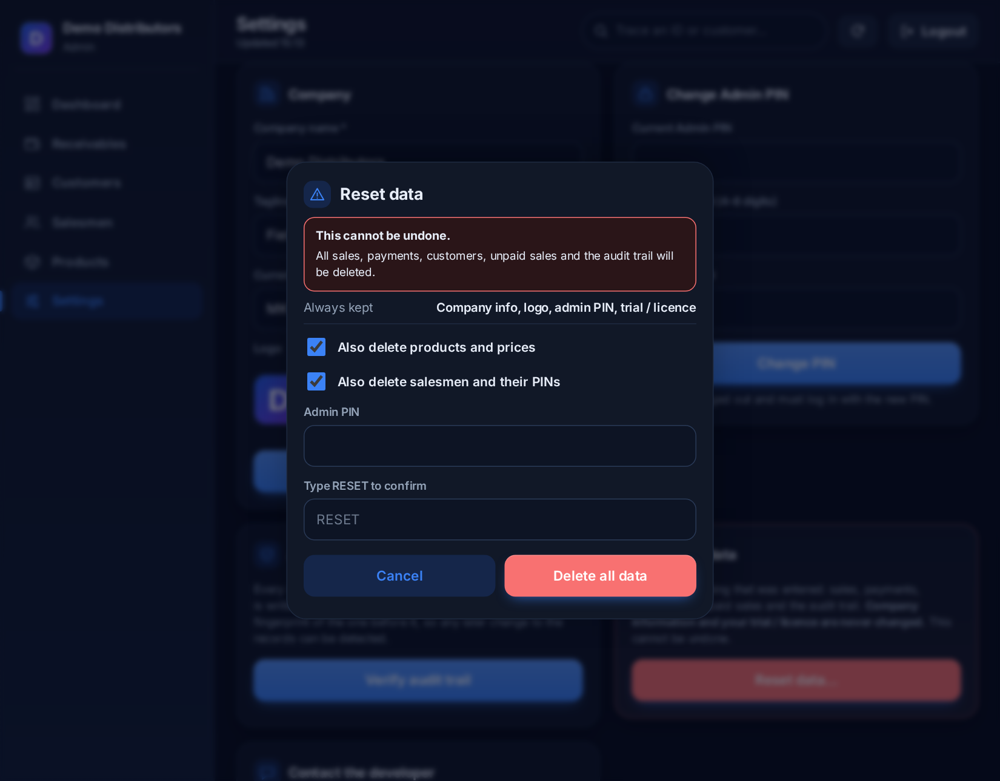 |

**On the phone**

  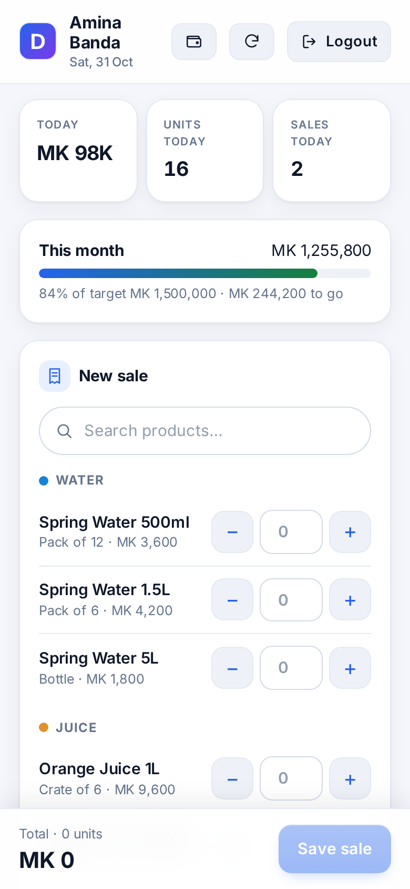
  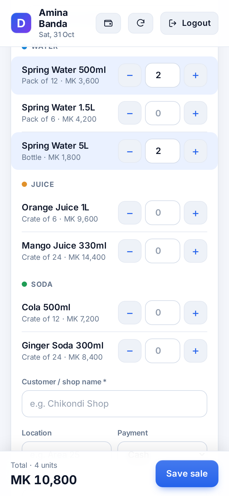
  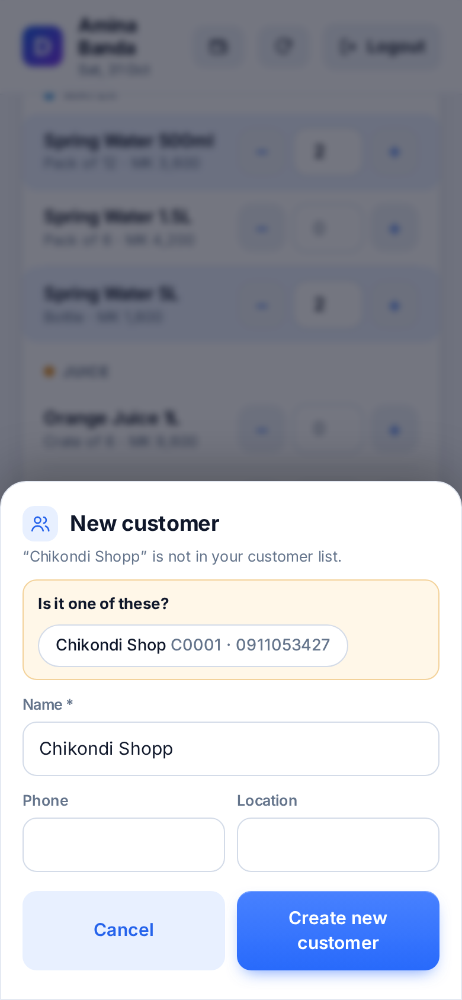
  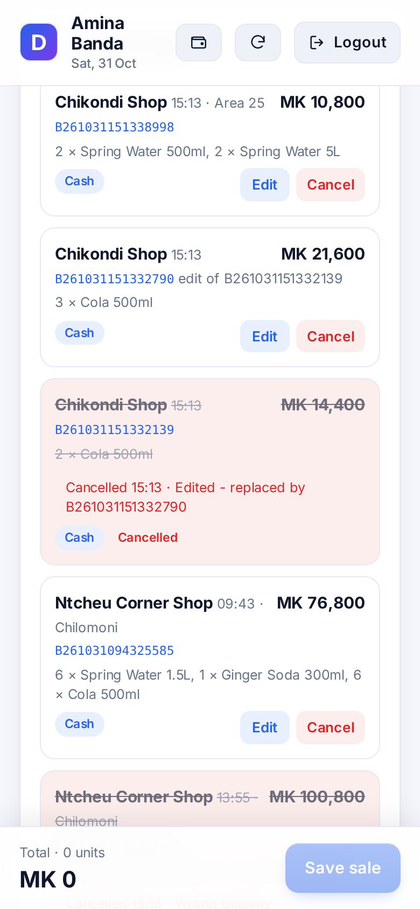
  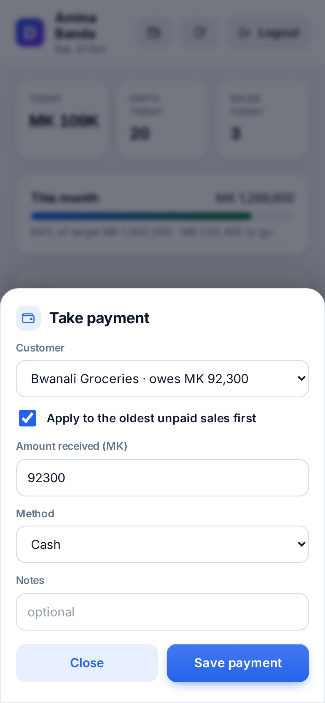

## Install (about 5 minutes)

You need a Google account. Everything below happens in your own account.

1. Go to [script.google.com](https://script.google.com) → **New project**.
2. Replace the default code with the contents of **`app/Code.gs`** and save.
3. Click **+** next to *Files* → **HTML**, name it exactly **`Index`**, paste **`app/Index.html`** and save.
4. Pick **`install`** in the function list and press **Run**. Approve the permissions. Open the **Execution log** and copy the **SETUP KEY**.
5. **Deploy → New deployment → Web app** → *Execute as: Me*, *Who has access: Anyone*. Open the link.
6. Enter the setup key, your company details and your products. Log in with PIN **0000** and change it in **Settings**.

When you change the code later, use **Deploy → Manage deployments → Edit → New version** so the link keeps the same address.

## How it is built

- **`Code.gs`** — the backend (runs on Google's servers): sign-in, sales, customer registry, invoices and payment allocation, the ledger, reports, setup and reset.
- **`Index.html`** — the whole interface (one file, no build step): salesman screen, admin panel, setup wizard.
- **Google Sheets** — the database. Open the "Sales Dashboard Data" spreadsheet to see sales, customers, payments, allocations and the ledger as plain tables.

Security notes: PINs are checked on the server, every action is authorised on the server, failed sign-ins are rate-limited, and spreadsheet formulas typed into text fields are neutralised. Share the spreadsheet with **view-only** access if others need to see it.

## Good to know

- Free **14-day trial** is included. After the trial the app needs to be activated by the developer (see below).
- Google Apps Script has daily quotas and gets slower with very large sheets (tens of thousands of sales). Archive old months to a separate sheet if you reach that scale.
- The audit trail detects changes to the ledger; it cannot stop someone with edit access to the spreadsheet from editing cells directly.

## Contact

Built by **Celal Çelikkaya** — https://celalcelikkaya.github.io
